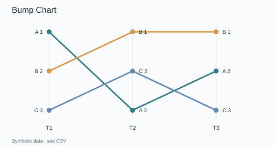

# 排名变化图｜案例分析

## 自制原理案例 CH-02-03-DEMO-01

- 来源：[示例数据](./06-示例数据.csv)，模拟数据，不是实际作品或公开统计。
- A 数据逻辑及 B 计算：对象×时间×名次；先按同口径值排序得到排名，明确并列处理。
- C 视觉编码：第一名置顶；纵向位置表示名次，线连接对象。
- D 信息架构：按 排名型 的任务组织字段、指标和图形，并配数据出处。
- E 视觉叙事：回答“相对顺序、领先程度与排名变化”这一研究方向下的明确问题，重点提示关键关系与限制。
- F 设计注意：排名差不等于数值差，必要时附原始值。

## 真实案例（待录入）

| 作品名称 | 原始来源 | 数据及单位 | 图形证据 | 设计分析 | 验证状态 |
| --- | --- | --- | --- | --- | --- |

[统计图形案例库](../../../04-统计图形案例库/README.md) · [02信息图形类型案例](../../../../02-信息图形类型案例/README.md)
