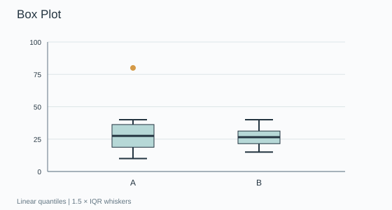

# 箱线图｜案例分析

## 自制原理案例 CH-04-02-DEMO-01

- 来源：[示例数据](./06-示例数据.csv)，模拟数据，不是实际作品或公开统计。
- A 数据逻辑及 B 计算：计算 Q1、中位数、Q3，IQR=Q3−Q1；本例线性插值分位数，须到1.5 IQR内最远观测。
- C 视觉编码：箱体为中间50%数据，线为中位数，须和独立点表达范围与异常线索。
- D 信息架构：按 分布型 的任务组织字段、指标和图形，并配数据出处。
- E 视觉叙事：回答“数据集中趋势、离散、形态与异常线索”这一研究方向下的明确问题，重点提示关键关系与限制。
- F 设计注意：离群点并不自动等于错误；说明分位数与须的定义。

## 真实案例（待录入）

| 作品名称 | 原始来源 | 数据及单位 | 图形证据 | 设计分析 | 验证状态 |
| --- | --- | --- | --- | --- | --- |

[统计图形案例库](../../../04-统计图形案例库/README.md) · [02信息图形类型案例](../../../../02-信息图形类型案例/README.md)
