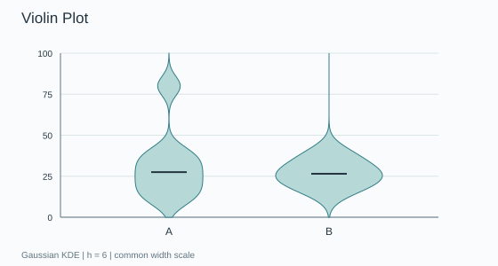

# 小提琴图｜C 视觉编码

沿数值轴镜像密度曲线，宽度反映估计密度。

## 设计表达

根据数据类型选择位置、长度、方向、面积、颜色、形状及符号；仅在真实编码需要时使用。以一致字体、间距、主次层级和必要标注支持叙事；图例注明单位与映射。

**本图重点与风险：** 小样本平滑形态可能不稳定；说明带宽、缩放及样本量。

关联[视觉编码与设计表达](../../../03-视觉编码与设计表达/README.md)、[ISOTYPE研究](../../../../03-ISOTYOPE信息图/README.md)、[格式塔原则](../../../../05-格式塔视觉组织原则/README.md)。
