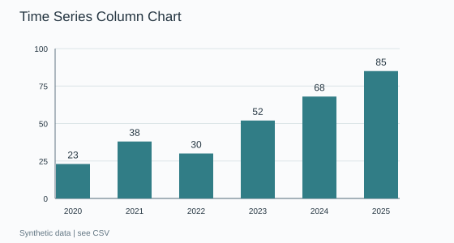

# 时间序列柱状图（Time Series Column Chart）

**图形编号：** CH-05-03  
**主类别：** 时间变化型  
**叙事任务：** 随时间发生的趋势、变化与累计。

## 定义

等时段柱形沿时间排序，柱高从零基线表示数值。

原理图基于本目录自建模拟数据，仅供方法研究，不代表真实统计。

- [01 数据逻辑与统计方法](./01-数据逻辑与统计方法.md)
- [02 视觉编码](./02-视觉编码.md)
- [03 原理示意（SVG）](./03-原理示意.svg)
- [04 案例分析](./04-案例分析.md)
- [05 设计实践经验](./05-设计实践经验.md)
- [06 示例数据（CSV）](./06-示例数据.csv)

[返回类别目录](../README.md)
