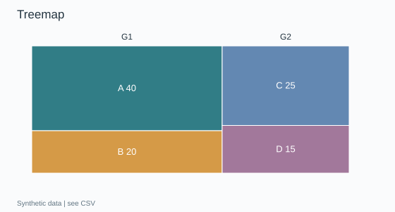

# 矩形树图｜案例分析

## 自制原理案例 CH-06-04-DEMO-01

- 来源：[示例数据](./06-示例数据.csv)，模拟数据，不是实际作品或公开统计。
- A 数据逻辑及 B 计算：层级路径与非负可加总权重；父级权重=子级之和。
- C 视觉编码：嵌套矩形面积按权重比例分配，本例使用切片布局。
- D 信息架构：按 整体构成型 的任务组织字段、指标和图形，并配数据出处。
- E 视觉叙事：回答“整体各部分的份额和结构”这一研究方向下的明确问题，重点提示关键关系与限制。
- F 设计注意：小矩形难读，不能重复计入父子值；必要时显示列表。

## 真实案例（待录入）

| 作品名称 | 原始来源 | 数据及单位 | 图形证据 | 设计分析 | 验证状态 |
| --- | --- | --- | --- | --- | --- |

[统计图形案例库](../../../04-统计图形案例库/README.md) · [02信息图形类型案例](../../../../02-信息图形类型案例/README.md)
