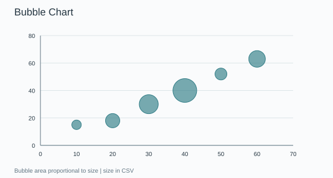

# 气泡图｜案例分析

## 自制原理案例 CH-07-02-DEMO-01

- 来源：[示例数据](./06-示例数据.csv)，模拟数据，不是实际作品或公开统计。
- A 数据逻辑及 B 计算：配对的 x、y 和非负第三变量；圆面积正比于 size。
- C 视觉编码：位置表达两个变量，面积表达第三变量，配套大小图例。
- D 信息架构：按 相关关系型 的任务组织字段、指标和图形，并配数据出处。
- E 视觉叙事：回答“两个或多个变量之间的关联”这一研究方向下的明确问题，重点提示关键关系与限制。
- F 设计注意：不能以半径直接映射面积；重叠和面积判断降低精度。

## 真实案例（待录入）

| 作品名称 | 原始来源 | 数据及单位 | 图形证据 | 设计分析 | 验证状态 |
| --- | --- | --- | --- | --- | --- |

[统计图形案例库](../../../04-统计图形案例库/README.md) · [02信息图形类型案例](../../../../02-信息图形类型案例/README.md)
