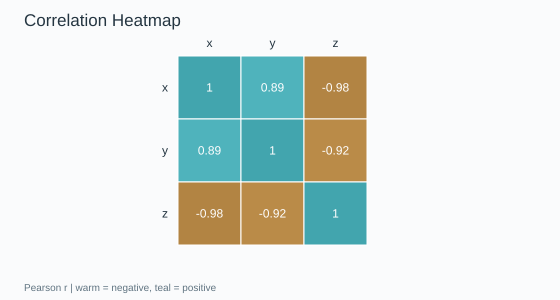

# 相关矩阵热力图（Correlation Heatmap）

**图形编号：** CH-07-03  
**主类别：** 相关关系型  
**叙事任务：** 两个或多个变量之间的关联。

## 定义

矩阵色阶范围固定−1至1，标出系数；对角为1。

原理图基于本目录自建模拟数据，仅供方法研究，不代表真实统计。

- [01 数据逻辑与统计方法](./01-数据逻辑与统计方法.md)
- [02 视觉编码](./02-视觉编码.md)
- [03 原理示意（SVG）](./03-原理示意.svg)
- [04 案例分析](./04-案例分析.md)
- [05 设计实践经验](./05-设计实践经验.md)
- [06 示例数据（CSV）](./06-示例数据.csv)

[返回类别目录](../README.md)
