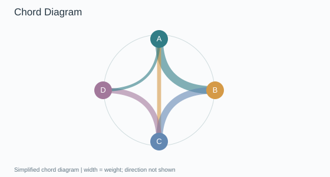

# 弦图｜案例分析

## 自制原理案例 CH-09-03-DEMO-01

- 来源：[示例数据](./06-示例数据.csv)，模拟数据，不是实际作品或公开统计。
- A 数据逻辑及 B 计算：节点间非负流量或关系权重；本例方向由 source/target 定义，图示只编码边权重，不编码方向。
- C 视觉编码：环形节点通过弦带连接；示例以线宽比例示意连接强弱。
- D 信息架构：按 流向关系型 的任务组织字段、指标和图形，并配数据出处。
- E 视觉叙事：回答“来源、去向、节点联系与流量”这一研究方向下的明确问题，重点提示关键关系与限制。
- F 设计注意：多边会遮挡；若要辨识方向需增加方向标记或用矩阵替代。

## 真实案例（待录入）

| 作品名称 | 原始来源 | 数据及单位 | 图形证据 | 设计分析 | 验证状态 |
| --- | --- | --- | --- | --- | --- |

[统计图形案例库](../../../04-统计图形案例库/README.md) · [02信息图形类型案例](../../../../02-信息图形类型案例/README.md)
