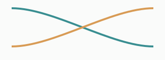

# Law of Good Continuation（良好连续律）

## A 基本概念

视觉系统倾向于将沿平滑方向延伸的元素感知为连续的轮廓、线条或路径。

## B 视觉知觉与组织机制

方向、对齐、曲率和切线连续性引导视线追踪路径，辅助辨认交叉关系。

两条不同方向的曲线平滑交叉，便于沿各自路径追踪。 本图是自制原理示意，不是实际作品或实验结果。

## C 信息图形应用

时间轴、流程图、地理路线图、关系网络图。

## D 设计原则与边界

减少无意义的交叉和急转折；真实分叉处设置节点和方向提示。

**注意：**线条在交叉处可能被误读为连接；连续的形状不能代替实际关系证据。

## 参考资料

- Wagemans et al. (2012), *A Century of Gestalt Psychology in Visual Perception I*, [DOI](https://doi.org/10.1037/a0029333).
- Palmer & Rock (1994), *Rethinking Perceptual Organization: The Role of Uniform Connectedness*（均匀连接专题）。
- [Interaction Design Foundation: Gestalt Principles](https://www.interaction-design.org/literature/topics/gestalt-principles)（设计应用参考）。
- [Nielsen Norman Group: Visual Design Principles](https://www.nngroup.com/articles/principles-visual-design/)（设计应用参考）。

[案例](./02-案例/README.md) · [设计分析](./03-设计分析/README.md) · [实践经验](./04-设计实践经验/README.md)
