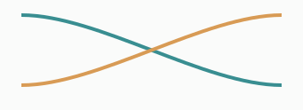

# 良好连续律｜案例

## 原理示意 G-03-DEMO-01

两条不同方向的曲线平滑交叉，便于沿各自路径追踪。

来源：本仓库自制示意。仅用于解释原理，不代表真实研究数据或已验证的设计效果。

## 既有信息图形案例关联

- [PPT03-P26-01｜原案例归档](../../../02-信息图形类型案例/05-%E6%B5%81%E7%A8%8B%E5%9B%BE%E5%9E%8B%EF%BC%88Process%20Infographics%EF%BC%89/README.md)：观察曲线路径是否帮助读者依次理解阶段。 **状态：候选，待重新核对原图及效果。**

## 新案例记录

| 案例编号 | 作品名称 | 来源链接 | 原理证据 | 验证状态 |
| --- | --- | --- | --- | --- |

真实案例优先链接02原记录，避免重复存图；授权明确的新案例图可附于原案例目录。

[返回本原则](../README.md)
